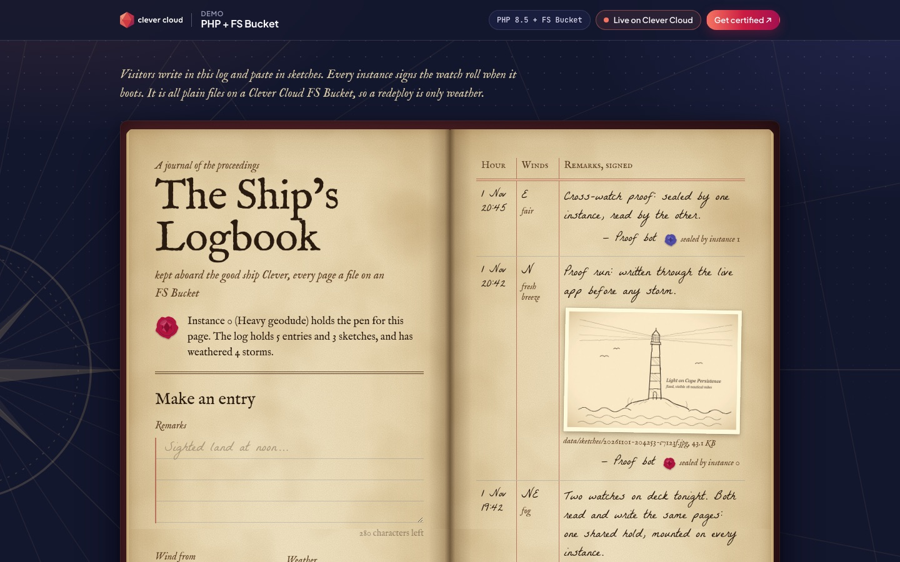
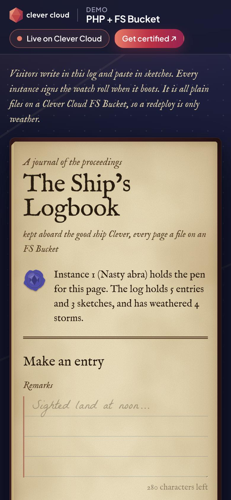

# The Ship's Logbook: a PHP app on a Clever Cloud FS Bucket

> An old ship's logbook that survives storms. Visitors write entries and paste in sketches, every instance signs the watch roll when it boots, and all of it is **plain files** on a Clever Cloud **FS Bucket** mounted on every instance. Redeploy, restart, scale to two instances: the log stays, and both instances read and write the same pages. Vanilla PHP 8.5, no database, no SDK.





**Run it yourself.** The hosted demo was taken down after the presales review (November 2026). The steps in [Deploy on Clever Cloud](#deploy-on-clever-cloud) recreate it from scratch in about 10 minutes.

## What the FS Bucket does here

| On the page | On the bucket | PHP |
|---|---|---|
| **Make an entry**, sealed with wax | `data/entries/<id>.json` (one file per entry) | `fopen` + `fwrite` + `fsync`, then `rename` (atomic) |
| A pasted sketch | `data/sketches/<id>.jpg` (images only, 2 MB max) | `move_uploaded_file` |
| **The watch roll**, each storm is a new deployment | `data/boot.log`, one line per instance start | `file_put_contents(FILE_APPEND \| LOCK_EX)` from `bin/boot.php` (pre-run hook) |
| **Hold inventory**: every file, size, date, and a load line at 100 MB | the whole mount | `RecursiveDirectoryIterator` |
| **Below deck**: every file call made to answer the page, with timings, and the NFS mount itself | `/proc/self/mountinfo` | plain file functions |
| **Hail the watches**: 8 requests, each instance says what it reads | the same files, from two instances | `scandir` |

Each instance has its own colour of sealing wax, so you can see at a glance which instance wrote an entry or signed the roll.

## Deploy on Clever Cloud

You need [clever-tools](https://www.clever.cloud/developers/doc/cli/) (`clever login` done) and the ID of the organisation that will own the resources (`orga_…`, shown in the Console). Run the commands from the repo root: `clever create` links the folder to the new app.

```bash
# 1. The app and its size
clever create --type php demo-fs-bucket --region par --org <org_id>
clever scale --min-flavor nano --max-flavor XS --min-instances 1 --max-instances 2
clever scale --build-flavor M

# 2. The FS Bucket (plan s, 100 MB free; no encryption option, it is not a database), linked to the app
clever addon create fs-bucket demo-fs-bucket-hold --plan s --region par --org <org_id>
clever service link-addon demo-fs-bucket-hold

# 3. Variables
clever env set CC_PHP_VERSION 8.5
clever env set CC_WEBROOT /public
clever env set CC_PRE_RUN_HOOK "php bin/boot.php"
clever env | grep '^BUCKET_HOST'                       # the bucket host injected by the add-on
clever env set CC_FS_BUCKET "/data:<bucket_host>"      # paste that host here
clever env set CC_HEALTH_CHECK_PATH /health

# 4. Deploy
clever deploy
clever open
```

There is no secret to generate. The setup runs by itself: `bin/boot.php`, the pre-run hook, signs the watch roll on every instance start and seeds the three first entries on the very first start. `GET /health/deep` checks that the folder is a real mount and writable.

The mount path is **relative to the application**: `CC_FS_BUCKET=/data:<host>` mounts the bucket on `$APP_HOME/data`, not on `/data`. The `data/` folder must not exist in the repository, or the bucket is not mounted (it is in `.gitignore`). The app reads the folder from `CC_FS_BUCKET` and `APP_HOME`, and refuses to write if nothing is mounted there.

Demo sizing: `nano` to `XS`, 1 to 2 instances, dedicated `M` build. Use `clever scale --min-instances 2` to show two instances sharing the bucket.

## Variables

| Variable | Set by | Role |
|---|---|---|
| `BUCKET_HOST` | the FS Bucket add-on | host of the bucket, used in `CC_FS_BUCKET` |
| `CC_FS_BUCKET` | you | mounts the bucket: `/data:<BUCKET_HOST>` |
| `CC_PRE_RUN_HOOK` | you | `php bin/boot.php`: signs `boot.log`, seeds the log on the very first start |
| `CC_WEBROOT` | you | `/public`, so `data/`, `src/` and `seed/` are never served |
| `CC_PHP_VERSION` | you | `8.5` |
| `CC_HEALTH_CHECK_PATH` | you | `/health` |
| `LOGBOOK_DATA_DIR` | local only | where to write when running on your machine (default `./data`) |

Shown in the "Running on Clever Cloud" panel, read-only: `CC_APP_NAME`, `APP_ID`, `INSTANCE_NUMBER`, `CC_PRETTY_INSTANCE_NAME`, `INSTANCE_TYPE`, `CC_COMMIT_ID`, `CC_DEPLOYMENT_ID`. Nothing else from the environment is printed; the NFS source of the mount is masked.

## Routes

| Route | Does |
|---|---|
| `GET /` | the logbook |
| `POST /entries` | seals an entry (form or `Accept: application/json`) |
| `GET /sketches/<file>` | serves a sketch from the bucket |
| `GET /api/hail` | which instance answered, and what it reads |
| `GET /health` | 200, never touches the bucket |
| `GET /health/deep` | the folder is a mount, and a probe file can be written, read back and deleted |

Every response carries `X-Logbook-Instance`, the instance that answered.

## Run it locally

```bash
./bin/serve.sh          # signs the watch roll, seeds, serves on http://127.0.0.1:8143
php tests/run.php       # 39 checks: the logbook class, then the real routes through php -S
```

Requires PHP 8.5 with the `fileinfo`, `gd` (tests only) and `curl` (tests only) extensions.

## Project structure

```
public/index.php      → routes: page, entries, sketches, hail, health
src/Logbook.php       → the logbook: every file operation on the bucket, traced
src/Platform.php      → the platform variables the page is allowed to show
templates/page.php    → the page
bin/boot.php          → pre-run hook: boot line + first seed
seed/                 → three first entries and two sketches drawn for the demo
public/assets/        → logbook.css, logbook.js (progressive enhancement only)
public/cc-brand.css   → Clever Brand Kit, copied as is
tests/run.php         → the test suite, no dependency
```

Source: https://github.com/Vitiosum/demo-fs-bucket

MIT License.
